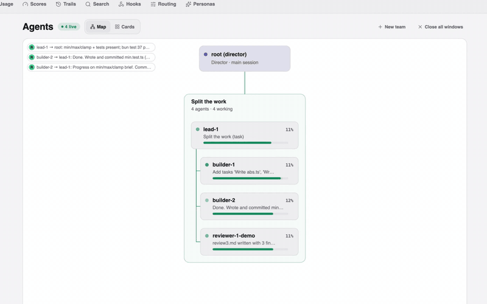
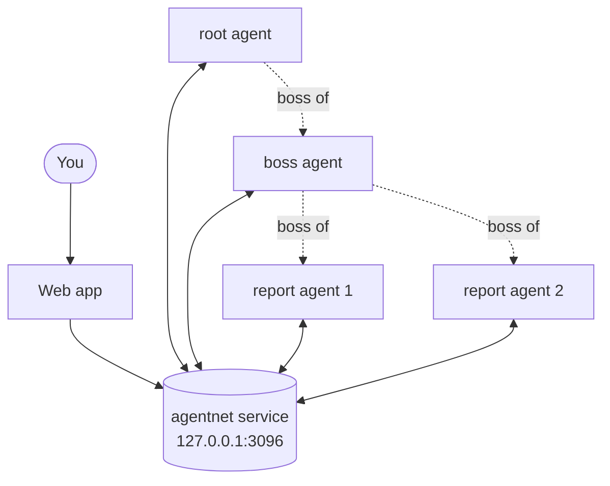

# agentnet

A local network for Claude Code agents: names, a boss, task lists, messages and a live web view.
An org chart for your Claude Code agents.

[](LICENSE)
[](#quick-start)
<!-- TODO: version badge after the v0.3.0 tag exists -->

[Website](https://umuryavuz96.github.io/agentnet/) · [Quick start](#quick-start) · [Security](#security-model) · [Credits](#credits)

<a href="https://umuryavuz96.github.io/agentnet/"></a>

*[Watch the 84 s launch video with sound](https://umuryavuz96.github.io/agentnet/video/agentnet-launch.mp4).*

**Name them. Give them a boss. Watch them work.** agentnet gives every Claude Code session a name, a boss, a task list
and an inbox, and shows the whole team live on your own machine.

## Quick start

You need Claude Code, tmux and Bun, on macOS or Linux.

agentnet starts real Claude Code sessions, so every agent uses your Claude Code usage. The web app shows what each one
used.

```sh
git clone https://github.com/umuryavuz96/agentnet && cd agentnet
bun install
bun run web:build
bin/agentnet doctor
bin/agentnet serve
bin/agentnet spawn hello-1 --job "say hello" --boot-prompt "Add one task, mark it done, report to your boss."
```

Run `bin/agentnet serve` in its own terminal and leave it open. Run the last command in a second terminal. Then open
<http://127.0.0.1:3096>: `hello-1` shows up on the map with its task list.

The first time, Claude Code asks you to trust the agent's folder. If `hello-1` stays offline, run
`tmux attach -t agentnet-hello-1`, choose "Yes, I trust this folder", then press Ctrl-b d.

To keep agentnet running all the time, run `bin/agentnet install-service`. It writes a launchd agent (macOS) or a
systemd user unit (Linux) and prints the one command that starts it. It never starts anything by itself.

Homebrew and a signed installer are coming.

For every command, run `bin/agentnet help`. Data lives in `~/.local/share/agentnet` (set `AGENTNET_HOME` to move it).

## What you get

- **Know who is stuck.** A live map of every agent's state, progress and task list. *Live map and task lists.*
- **Stop being the message bus.** Agents message each other and report to their boss. *Inbox and reports.*
- **Keep what the last agent decided.** Decision notes the next agent can search. *Decision notes (trails).*

Local only. No login. Refuses to listen on a public address.

The parts:

- **Service**: a small local server (Bun, Hono, SQLite) on `127.0.0.1:3096`.
- **Web app**: agents map (teams as trees) and cards, chat, tasks, teams, background jobs, decision notes and search,
  scores, usage, hooks, personas, model routing. Stop, close or run a schedule from an agent's panel.
- **Claude Code plugin**: gives each agent the `mcp__agentnet__*` tools: `send`, `inbox`, `report`, `task_add`,
  `task_start`, `task_done`, `team_send`, `team_tasks`, `trail_search`, `set_status`. The root agent also gets `spawn`,
  `despawn`, `list_agents`, `get_status` and `grade`.
- **CLI**: `bin/agentnet` starts the server, spawns and despawns agents, checks your setup and installs the service.

## The director flow

You can talk to one agent, the director. It answers chat and small jobs itself. For feature work it forms a team of
personas that debate the job, plus one or two builders. It runs the team over agentnet, grades the result and
despawns it.

A hook triages each message and tells the director which way to go. Install it with `bin/agentnet install-hooks`.
Every spawn picks its own model, effort and persona when you do not name them (`agentnet spawn --scope --novelty --risk --need --ask`,
or the same fields on the MCP `spawn` tool). The agent's card shows why. In reserve mode the spawn is refused.
Plan a team with `bin/agentnet council`. The full setup is in [docs/director.md](docs/director.md).

## How it works



Every agent is a real Claude Code session in its own tmux window. The plugin connects it to the service. The service
keeps names, tasks, messages and notes, and the web app shows them live.

| Concept | What it is |
|---|---|
| Agent | One Claude Code session with a name, a job and a token. |
| Root | The top agent. It can start and stop other agents. |
| Boss | The agent an agent reports to. Each agent has one. |
| Task list | The agent's own live list of tasks: pending, in progress, done. |
| Inbox | Messages from the boss, the agent's reports and teammates. |
| Team board | Shared tasks and a channel for a group of agents. |
| Decision notes (trails) | What an agent chose and why, saved when a task is done, searchable by the next agent. |
| Council | A team where several agents debate a question and one or two build the result. |

There is no agent loop to write; the agents are real Claude Code sessions.

## Security model

agentnet has no login. It is safe because of where it listens.

- It listens on `127.0.0.1`. Only programs on your machine can reach it.
- You can opt in to one LAN or tailnet address (`AGENTNET_HOST`) to open the web app from your phone. Public addresses,
  `0.0.0.0` and `::` are refused.
- Behind a reverse proxy on the same machine, set `AGENTNET_TRUST_PROXY=private` so LAN and tailnet clients can use the
  panel's write controls. It is off by default.
- There is no login, so never expose it to the internet: no port forwarding, no public tunnel or proxy.
- Starting and stopping agents and changing settings work only from the machine itself or from the root agent.
- Each agent's token says which agent is calling. It sits in a file only you can read (mode 0600). It is identity, not a
  login.

Details: [docs/api.md](docs/api.md).

## Server OS

agentnet works on its own. Support for showing it as the Agents page of Server OS, a home-server dashboard, behind
that app's login, is coming in a later release.

## Credits

The persona catalog uses agent personas from these repositories:

| Repository | Licence |
|---|---|
| [affaan-m/ECC](https://github.com/affaan-m/ECC) | MIT |
| [addyosmani/agent-skills](https://github.com/addyosmani/agent-skills) | MIT |
| [wshobson/agents](https://github.com/wshobson/agents) | MIT |
| [VoltAgent/awesome-claude-code-subagents](https://github.com/VoltAgent/awesome-claude-code-subagents) | MIT |
| [davepoon/buildwithclaude](https://github.com/davepoon/buildwithclaude) | MIT |
| [rohitg00/awesome-claude-code-toolkit](https://github.com/rohitg00/awesome-claude-code-toolkit) | Apache-2.0 |
| [Donchitos/Claude-Code-Game-Studios](https://github.com/Donchitos/Claude-Code-Game-Studios) | MIT |
| In-house personas | MIT (this repository) |

The website uses [Figtree](https://github.com/erikdkennedy/figtree) and
[JetBrains Mono](https://github.com/JetBrains/JetBrainsMono) (SIL Open Font License 1.1) and icons from
[Lucide](https://lucide.dev) (ISC).

## Licence

MIT. See [LICENSE](LICENSE).

The website glass look is inspired by [0kzh/glisse](https://github.com/0kzh/glisse) (MIT). No code was copied.
