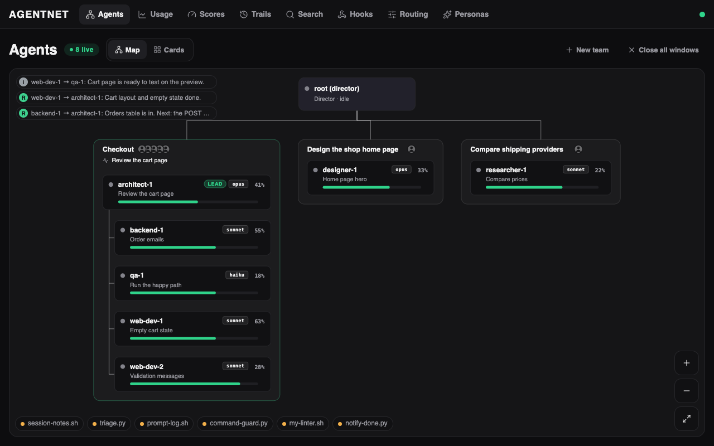
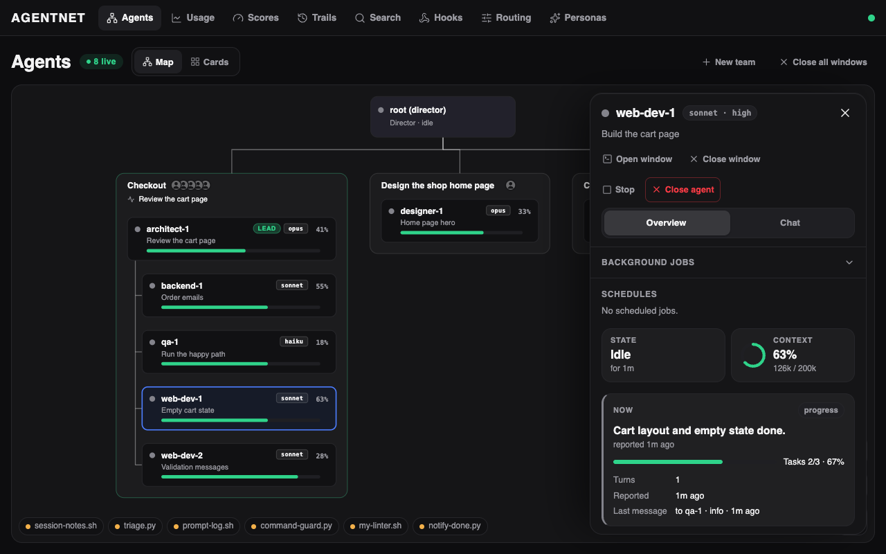
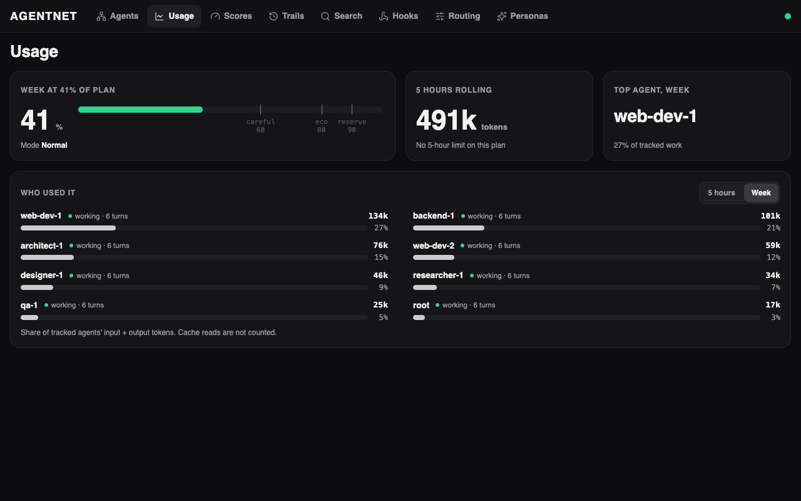
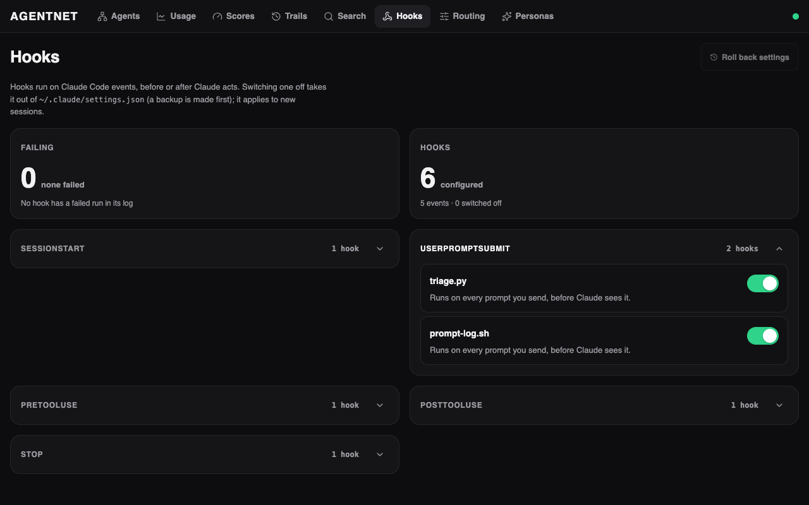
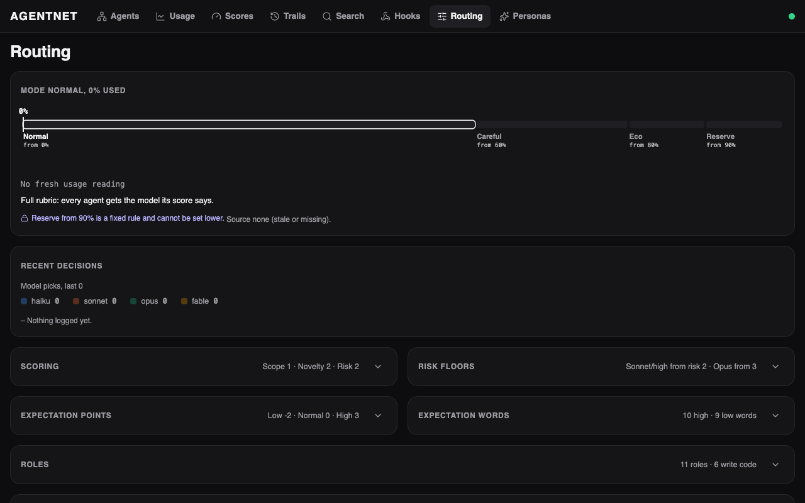

# agentnet 0.3.0

A redesigned web app, a smarter Agents map, and controls to run, stop and close agents from the panel.
Spawning now picks the model, effort, persona, name and team for you.
Teams get a lead gate: members are reached through their lead.

## Highlights

### The Agents map shows who works for whom

Teams draw as a tree with the lead on top. Cards wrap to new rows and glide when the layout changes.
Each card shows the model and its context use.

### Control an agent from its panel

Stop interrupts an agent. Close ends it, after a red confirm card that says what will happen.
Schedules and monitors list with a Run now button. The boss gets a short notice for every action.

### Bento pages

Usage, Scores, Trails, Hooks and Routing are now cards in one shared grid.

### Hooks and Routing, folded and clear

Folds open from the whole header, animate, and work with the keyboard.

### Spawning that places itself

`spawn` fills in what you leave out: role from the job text, next free name, boss, team, model, effort and persona.
`agentnet plan-spawn --job "..."` shows the plan and the reasons without changing anything.

See [CHANGELOG.md](../../CHANGELOG.md) for the full list.

## Upgrade notes

1. Pull the new version, then run `bun install` and `bun run web:build`.
2. Restart the service. The store adds two columns to the agents table by itself (`compact_window`, `audit`). Nothing else migrates.
3. Run `bin/agentnet doctor` to check your setup.

### New settings (all optional)

| Setting | What it does |
|---|---|
| `AGENTNET_TRUST_PROXY=private` | Lets a reverse proxy on the same machine pass clients from your LAN or tailnet as local users, so the panel can write. The proxy must set `X-Forwarded-For` itself. Off by default. Never use it with a proxy open to the internet. |
| `config/placement.json` in your data folder (`AGENTNET_PLACEMENT_FILE`) | Rules for where a new agent lands: role keywords, naming, team by project. |
| `config/spawn.json` (`AGENTNET_SPAWN_FILE`) | The auto-compact window default and per-role values. Also editable in the panel. |
| `AGENTNET_JOBS_JSON`, `AGENTNET_ALL_CRON` | Opt-in. A JSON file of job cards (`{"job": {"agent": "name"}}`) and a crontab whose lines run through `cron_wrap.sh "job"`. With both set, the Schedules section lists the cron jobs linked to each agent and Run now starts them. Unset, it shows session schedules and monitors only. |
| `AGENTNET_OWNER_NAME` | The name used in the admin messages that Stop, Close and Run now send to the agent's boss. Defaults to "The owner". |

## Breaking changes

None to the API. Two behaviour changes:

- **Lead gate.** A member of an active team that has a lead can only be messaged or given tasks through that lead. This includes the root agent. Teammates and the lead still talk freely. Send to the lead, or remove the lead from the team.
- **Boss follows the lead.** When a team gets, changes or loses its lead, its members get a new boss automatically.

New routes: `/v1/admin/plan-spawn`, `/v1/panel/agents/{name}/schedules`, `stop`, `despawn`, `run-schedule`, and `/v1/panel/compact`. See `spec/openapi.yaml`.
